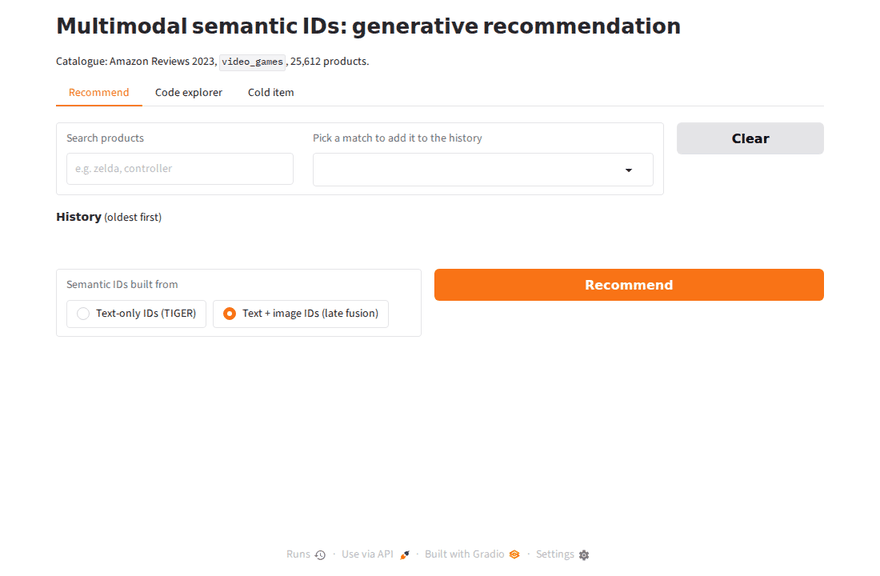
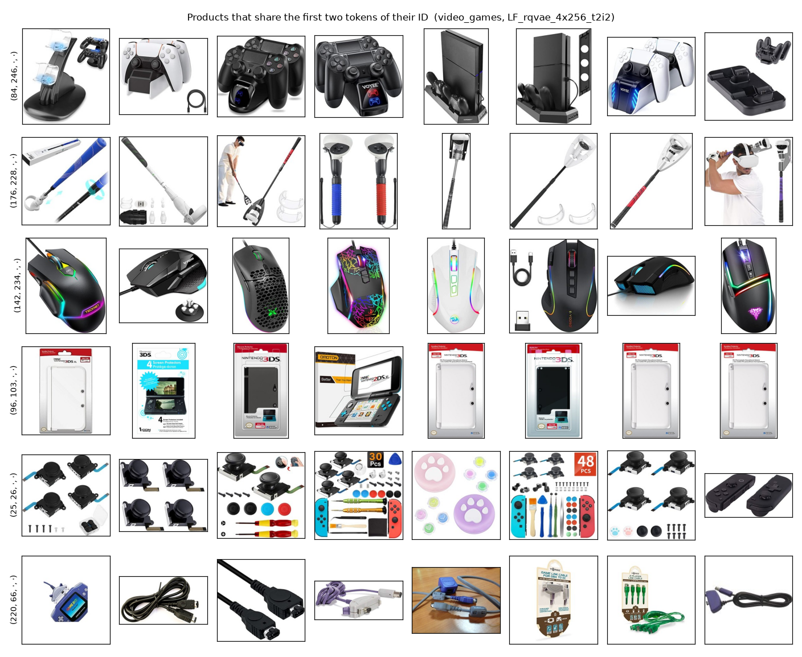

# Multimodal Semantic IDs for Generative Recommendation

I built a generative recommender that represents every product as a short code learned from its **image and text**, then generates the code of the next product a user will buy. I used it to test whether adding images to these codes helps, compared with the text-only codes of the original TIGER method.



## What I found

- **Codes built from text and images beat text-only codes, if the two are kept on separate levels.** Late fusion raised NDCG@10 over text-only IDs in all four settings: 0.0294 to 0.0332 and 0.0068 to 0.0086 on Video_Games, 0.0055 to 0.0075 and 0.0016 to 0.0023 on Toys_and_Games. The paired bootstrap interval excludes zero every time.
- **How the modalities are fused matters more than whether an image is used.** Concatenating the two embeddings before quantising (early fusion) was no better than text alone in three of four settings, and image-only codes were never significantly better than text-only codes.
- **The gain is not on cold or tail items.** No generative model retrieved a single cold item in either time split (Recall@10 of 0.0000), and tail recall stayed at or below 0.0004. The improvement comes from mid and head items.
- **A plain SASRec fed the same frozen text and image embeddings beat every generative model.** For example NDCG@10 of 0.0129 against 0.0075 on Toys_and_Games, at a fraction of the training and inference cost.

Everything here is from one seed, so the bootstrap over test users is the only uncertainty estimate I have.

## Why I built this

Generative retrieval with semantic IDs is replacing the classic "embedding table plus nearest-neighbour search" design in large recommenders. The codes are normally built from item text alone. Many products, though, are chosen by how they look. I wanted to know whether a code that also encodes the image carries more useful signal, and for which items.

I started from three hypotheses:

| | Hypothesis | Outcome |
|---|---|---|
| H1 | Multimodal IDs help on a visually driven category and make little difference on a specification-driven one | Partly. The relative gain of late fusion is larger on Toys_and_Games (36% and 44%) than on Video_Games (13% and 26%), but it is clearly there on both |
| H2 | Most of the gain is on tail and cold items | Rejected. Cold recall is zero for every variant and tail recall is near zero |
| H3 | Late fusion beats early fusion | Supported in all four settings |

## How it works


1. **Embed.** I encode each product's text (title, brand, category, price, first features) with Sentence-T5 base and its main image with the SigLIP base image tower.
2. **Quantise.** An RQ-VAE turns the embeddings into a 4-token code, so similar products share a prefix. A fifth token separates products that end up with the same code. I compared four ways of building the code: text only, image only, early fusion (concatenate, then quantise) and late fusion (two levels from text, then two from the image). The quantisers are fitted on items seen in training only.
3. **Generate.** A small encoder-decoder transformer (4 + 4 layers, 128 dimensions), trained from scratch, reads the codes of a user's last 20 products and generates the next code with beam search restricted to codes that exist.

## Data

[Amazon Reviews 2023](https://amazon-reviews-2023.github.io/) (McAuley Lab), 5-core benchmark splits. I do not redistribute the data; the download script fetches it from the official source.

| Category | Users | Items | Interactions | Items with an image |
|---|---|---|---|---|
| Video_Games | 94,762 | 25,612 | 814,586 | 99.98% |
| Toys_and_Games (100,000 sampled users) | 100,000 | 147,458 | 891,152 | 99.99% |

I report two protocols: leave-last-out (the standard academic setting) and an absolute time split (closer to production, and the only one with cold items). In the time split 60% of Video_Games test targets and 67% of Toys_and_Games test targets were never seen in training. Details are in [docs/data_audit.md](docs/data_audit.md).

## Results

All metrics rank against the full catalogue: 25,612 or 147,458 items, no sampled negatives. One seed per configuration. Every table below is generated by `scripts/make_results_tables.py` from the `metrics.json` files under `results/`; the full set, with history-length slices and the tokeniser report, is in [results/tables.md](results/tables.md).

### Main result: which code works best

**Video_Games, leave-last-out**

| Semantic ID built from | Recall@5 | NDCG@5 | Recall@10 | NDCG@10 | Recall@10 (tail) | Recall@10 (mid) | Recall@10 (head) |
|---|---|---|---|---|---|---|---|
| Text only (TIGER) | 0.0351 | 0.0223 | 0.0571 | 0.0294 | 0.0001 | 0.0022 | 0.0888 |
| Image only | 0.0318 | 0.0204 | 0.0523 | 0.0270 | 0.0002 | 0.0011 | 0.0816 |
| Text + image, early fusion | 0.0354 | 0.0226 | 0.0579 | 0.0298 | 0.0001 | 0.0021 | 0.0902 |
| Text + image, late fusion | 0.0391 | 0.0251 | 0.0641 | 0.0332 | 0.0004 | 0.0043 | 0.0991 |

**Video_Games, time split**

| Semantic ID built from | Recall@5 | NDCG@5 | Recall@10 | NDCG@10 | Recall@10 (tail) | Recall@10 (mid) | Recall@10 (head) | Recall@10 (cold) |
|---|---|---|---|---|---|---|---|---|
| Text only (TIGER) | 0.0078 | 0.0049 | 0.0138 | 0.0068 | 0.0000 | 0.0003 | 0.0746 | 0.0000 |
| Image only | 0.0076 | 0.0048 | 0.0137 | 0.0067 | 0.0000 | 0.0003 | 0.0745 | 0.0000 |
| Text + image, early fusion | 0.0062 | 0.0039 | 0.0128 | 0.0060 | 0.0000 | 0.0000 | 0.0694 | 0.0000 |
| Text + image, late fusion | 0.0102 | 0.0061 | 0.0176 | 0.0086 | 0.0000 | 0.0033 | 0.0941 | 0.0000 |

**Toys_and_Games, leave-last-out**

| Semantic ID built from | Recall@5 | NDCG@5 | Recall@10 | NDCG@10 | Recall@10 (tail) | Recall@10 (mid) | Recall@10 (head) |
|---|---|---|---|---|---|---|---|
| Text only (TIGER) | 0.0064 | 0.0042 | 0.0104 | 0.0055 | 0.0001 | 0.0002 | 0.0199 |
| Image only | 0.0069 | 0.0044 | 0.0108 | 0.0056 | 0.0001 | 0.0003 | 0.0206 |
| Text + image, early fusion | 0.0075 | 0.0047 | 0.0121 | 0.0062 | 0.0001 | 0.0002 | 0.0232 |
| Text + image, late fusion | 0.0086 | 0.0057 | 0.0140 | 0.0075 | 0.0004 | 0.0010 | 0.0264 |

**Toys_and_Games, time split**

| Semantic ID built from | Recall@5 | NDCG@5 | Recall@10 | NDCG@10 | Recall@10 (tail) | Recall@10 (mid) | Recall@10 (head) | Recall@10 (cold) |
|---|---|---|---|---|---|---|---|---|
| Text only (TIGER) | 0.0019 | 0.0011 | 0.0034 | 0.0016 | 0.0000 | 0.0000 | 0.0193 | 0.0000 |
| Image only | 0.0016 | 0.0010 | 0.0029 | 0.0014 | 0.0000 | 0.0000 | 0.0164 | 0.0000 |
| Text + image, early fusion | 0.0020 | 0.0011 | 0.0034 | 0.0016 | 0.0001 | 0.0000 | 0.0196 | 0.0000 |
| Text + image, late fusion | 0.0027 | 0.0017 | 0.0045 | 0.0023 | 0.0001 | 0.0003 | 0.0257 | 0.0000 |

Tail, mid and head are the bottom 50%, next 30% and top 20% of training items by popularity. Cold items have no training interaction.

Paired bootstrap over test users (2,000 resamples), difference in NDCG@10. The last row of each block compares the best generative model with the best SASRec, both picked on validation.

| Data | Split | A | B | Difference | 95% CI | p |
|---|---|---|---|---|---|---|
| vg | lastout | vg_lastout_LF | vg_lastout_T | +0.0038 | [+0.0031, +0.0044] | 0.000 |
| vg | lastout | vg_lastout_EF | vg_lastout_T | +0.0004 | [-0.0003, +0.0011] | 0.259 |
| vg | lastout | vg_lastout_I | vg_lastout_T | -0.0024 | [-0.0031, -0.0018] | 0.000 |
| vg | lastout | vg_lastout_LF | vg_lastout_sasrec_id_text_image | -0.0141 | [-0.0151, -0.0131] | 0.000 |
| vg | time | vg_time_LF | vg_time_T | +0.0018 | [+0.0012, +0.0023] | 0.000 |
| vg | time | vg_time_EF | vg_time_T | -0.0008 | [-0.0012, -0.0004] | 0.001 |
| vg | time | vg_time_I | vg_time_T | -0.0001 | [-0.0006, +0.0005] | 0.776 |
| vg | time | vg_time_LF | vg_time_sasrec_id_text_image | -0.0004 | [-0.0012, +0.0004] | 0.316 |
| toys | lastout | toys_lastout_LF | toys_lastout_T | +0.0020 | [+0.0016, +0.0023] | 0.000 |
| toys | lastout | toys_lastout_EF | toys_lastout_T | +0.0007 | [+0.0003, +0.0010] | 0.000 |
| toys | lastout | toys_lastout_I | toys_lastout_T | +0.0001 | [-0.0002, +0.0005] | 0.433 |
| toys | lastout | toys_lastout_LF | toys_lastout_sasrec_text_image | -0.0054 | [-0.0059, -0.0049] | 0.000 |
| toys | time | toys_time_LF | toys_time_T | +0.0007 | [+0.0005, +0.0008] | 0.000 |
| toys | time | toys_time_EF | toys_time_T | +0.0000 | [-0.0002, +0.0002] | 0.918 |
| toys | time | toys_time_I | toys_time_T | -0.0002 | [-0.0004, -0.0001] | 0.012 |
| toys | time | toys_time_LF | toys_time_sasrec_text_image | -0.0015 | [-0.0018, -0.0012] | 0.000 |

### Against dense baselines

The SASRec baselines use the same `(history, target)` rows and a full-softmax loss. Their dimension and dropout were picked on a validation grid; the content variants put an MLP on the same frozen Sentence-T5 and SigLIP embeddings that the semantic IDs are built from.

**Video_Games, leave-last-out**

| Model | Recall@10 | NDCG@10 | Recall@10 (cold) | Train GPU-hours | Inference ms/user | Peak GPU GB |
|---|---|---|---|---|---|---|
| Popularity | 0.0243 | 0.0123 | – | – | – | – |
| Popularity, last 90 days | 0.0079 | 0.0055 | – | – | – | – |
| SASRec (IDs) | 0.0812 | 0.0421 | – | 0.31 | 0.15 | 0.2 |
| SASRec (text features) | 0.0574 | 0.0299 | – | 0.34 | 0.16 | 0.4 |
| SASRec (text + image features) | 0.0812 | 0.0419 | – | 0.35 | 0.16 | 0.5 |
| SASRec (IDs + text + image) | 0.0927 | 0.0473 | – | 0.34 | 0.12 | 0.5 |
| Generative, best semantic ID (LF) | 0.0641 | 0.0332 | – | 1.54 | 4.93 | 2.5 |

**Video_Games, time split**

| Model | Recall@10 | NDCG@10 | Recall@10 (cold) | Train GPU-hours | Inference ms/user | Peak GPU GB |
|---|---|---|---|---|---|---|
| Popularity | 0.0043 | 0.0021 | 0.0000 | – | – | – |
| Popularity, last 90 days | 0.0126 | 0.0069 | 0.0000 | – | – | – |
| SASRec (IDs) | 0.0119 | 0.0064 | 0.0000 | 0.22 | 0.07 | 0.2 |
| SASRec (text features) | 0.0164 | 0.0083 | 0.0032 | 0.33 | 0.38 | 0.4 |
| SASRec (text + image features) | 0.0223 | 0.0117 | 0.0012 | 0.39 | 0.43 | 0.5 |
| SASRec (IDs + text + image) | 0.0177 | 0.0090 | 0.0000 | 0.38 | 0.33 | 0.5 |
| Generative, best semantic ID (LF) | 0.0176 | 0.0086 | 0.0000 | 1.64 | 5.27 | 2.5 |

**Toys_and_Games, leave-last-out**

| Model | Recall@10 | NDCG@10 | Recall@10 (cold) | Train GPU-hours | Inference ms/user | Peak GPU GB |
|---|---|---|---|---|---|---|
| Popularity | 0.0050 | 0.0023 | – | – | – | – |
| Popularity, last 90 days | 0.0005 | 0.0002 | – | – | – | – |
| SASRec (IDs) | 0.0097 | 0.0053 | – | 0.39 | 0.27 | 0.6 |
| SASRec (text features) | 0.0118 | 0.0059 | – | 0.53 | 0.37 | 1.5 |
| SASRec (text + image features) | 0.0251 | 0.0129 | – | 0.65 | 0.58 | 2.1 |
| SASRec (IDs + text + image) | 0.0214 | 0.0110 | – | 0.28 | 0.93 | 2.2 |
| Generative, best semantic ID (LF) | 0.0140 | 0.0075 | – | 1.51 | 4.71 | 5.8 |

**Toys_and_Games, time split**

| Model | Recall@10 | NDCG@10 | Recall@10 (cold) | Train GPU-hours | Inference ms/user | Peak GPU GB |
|---|---|---|---|---|---|---|
| Popularity | 0.0015 | 0.0006 | 0.0000 | – | – | – |
| Popularity, last 90 days | 0.0018 | 0.0012 | 0.0000 | – | – | – |
| SASRec (IDs) | 0.0010 | 0.0004 | 0.0000 | 0.09 | 0.46 | 0.6 |
| SASRec (text features) | 0.0047 | 0.0023 | 0.0026 | 0.59 | 0.30 | 1.5 |
| SASRec (text + image features) | 0.0075 | 0.0037 | 0.0022 | 0.60 | 0.29 | 2.1 |
| SASRec (IDs + text + image) | 0.0032 | 0.0016 | 0.0002 | 0.37 | 0.66 | 2.3 |
| Generative, best semantic ID (LF) | 0.0045 | 0.0023 | 0.0000 | 2.36 | 2.45 | 2.6 |

Only the SASRec variants without an ID embedding recommend any cold item at all. In the time split a model with ID embeddings, or one that has to generate an exact code it never saw as a target, has nothing to go on.

### Does my implementation match the paper?

Before using new data I ran TIGER and SASRec on the paper's Amazon Beauty dataset.

| Beauty 2014 | Recall@5 (paper) | Recall@5 (mine) | NDCG@5 (paper) | NDCG@5 (mine) | Recall@10 (paper) | Recall@10 (mine) | NDCG@10 (paper) | NDCG@10 (mine) |
|---|---|---|---|---|---|---|---|---|
| TIGER | 0.0454 | 0.0305 | 0.0321 | 0.0195 | 0.0648 | 0.0506 | 0.0384 | 0.0260 |
| SASRec | 0.0387 | 0.0449 | 0.0249 | 0.0323 | 0.0605 | 0.0621 | 0.0318 | 0.0378 |

My SASRec is above the paper's number, as a cross-entropy SASRec usually is. My TIGER is not a faithful reproduction: it reaches 78% of the paper's Recall@10 and 68% of its NDCG@10. The differences I know of are the training budget (my best checkpoint is at 44,000 steps, the paper trains for 200,000), the optimiser for both the RQ-VAE and the transformer, and a single seed. So the comparisons between ID variants above are fair to each other, since they share one implementation and budget, but the gap to SASRec is probably somewhat wider here than a fully tuned TIGER would show.

### What the codes mean



Each row shows eight Video_Games products that share the first two tokens of their late-fusion ID. Every codebook is fully used in every variant. Two products with the same two-token prefix share a leaf category 68% of the time for late fusion on Video_Games, against 63% for text-only codes and 22% for two random products. The price of late fusion is more collisions: 5.2% of Video_Games items and 10.3% of Toys_and_Games items need a non-zero collision token, against 1.4% and 1.7% for text-only codes.

## What I learned

- **The most surprising result** was that content-based codes did nothing for cold items. I expected the codes to let the model reach unseen products through their prefix. In practice the model only ever generates codes it has seen as training targets, and the top beam gets even the first token right only 5 to 10% of the time.
- **What did not work:** early fusion. Quantising the concatenated vector gave a code that is no more useful than the text code, even though its reconstruction error and codebook usage look healthy. Tokeniser metrics alone did not predict which code would recommend best.
- **Generative retrieval has a popularity problem here.** On Video_Games leave-last-out the generative models cover 5 to 9% of the catalogue in their top-10 lists, against 34% for SASRec with IDs, and recommend items that are about 1.5 to 1.9 times as popular.
- **Engineering lessons.** The paper's Adagrad setting for the RQ-VAE diverged in PyTorch and AdamW fixed it. Constrained decoding as a Python callback was too slow, so I flattened the trie into per-level lookup tables. And the T5 key/value cache at 50 beams held about 1 GB per decoder layer, which ran a shared GPU out of memory in evaluation until I switched it off. More in [docs/notes.md](docs/notes.md).

## Demo

```bash
uv run python scripts/export_demo_bundle.py   # once, after training
uv run python demo/app.py
```

The app has three tabs: build a history and get recommendations with either kind of ID, browse the products behind any code prefix, and see which code a brand-new product would get from its title and image. It runs on CPU. `scripts/record_demo.py` regenerates the GIF above.

## Reproduce

```bash
git clone https://github.com/limon-7/mm-semantic-ids && cd mm-semantic-ids
uv sync --extra demo
export RS_DATA=/path/to/data
make smoke                                  # short end-to-end run on the tiny All_Beauty set
make data embed CATEGORY=video_games        # download, preprocess, fetch images, embed
make data embed CATEGORY=toys_and_games
scripts/run_matrix.sh 0                     # every run in the tables, on GPU 0
uv run python scripts/analyse.py && make tables
```

`uv run python -m mmsid.data.beauty2014` followed by `make embed CATEGORY=beauty2014` and `make train EXP=beauty2014_tiger` reruns the reproduction (the image step can be skipped there). A run that is stopped continues from its last validation step when the same command is given again, and finished runs are skipped.

Hardware used: one or two shared NVIDIA RTX A5000 cards. A generative run takes 1.5 to 2.4 GPU-hours and 2.5 to 5.8 GB; all runs together, including tuning, took about 37 GPU-hours.

## Repository layout

```
configs/    defaults, datasets, encoders and experiments
src/mmsid/  data, embeddings, tokenisers, models, evaluation
demo/       Gradio app
scripts/    experiment runner, tuning grid, analysis, results tables, figures
tests/      metric, split, model and end-to-end tests
results/    metrics.json and config for every reported run
docs/       data audit and implementation notes
```

## Limitations

- One seed, two categories, one text encoder, one image encoder and one ID shape. I did not run the planned ablations over the quantiser, the ID shape or the late-fusion order.
- The generative model was trained for far fewer steps than in the TIGER paper and does not reproduce its Beauty numbers, so the comparison with SASRec favours SASRec.
- Almost every item has an image, so the stand-in for missing images (the SigLIP text tower) is implemented but could not be evaluated.
- Offline evaluation only. I have no way to measure online behaviour.

## References

- Rajput et al., "Recommender Systems with Generative Retrieval", NeurIPS 2023.
- Hou et al., "Bridging Language and Items for Retrieval and Recommendation", 2024 (Amazon Reviews 2023).
- Kang and McAuley, "Self-Attentive Sequential Recommendation", ICDM 2018.
- Lee et al., "Autoregressive Image Generation using Residual Quantization", CVPR 2022 (RQ-VAE).
- Zhai et al., "Sigmoid Loss for Language Image Pre-Training", ICCV 2023 (SigLIP).
- Krichene and Rendle, "On Sampled Metrics for Item Recommendation", KDD 2020.

## Licence

Code: MIT. The dataset keeps its own terms; see the dataset page.
